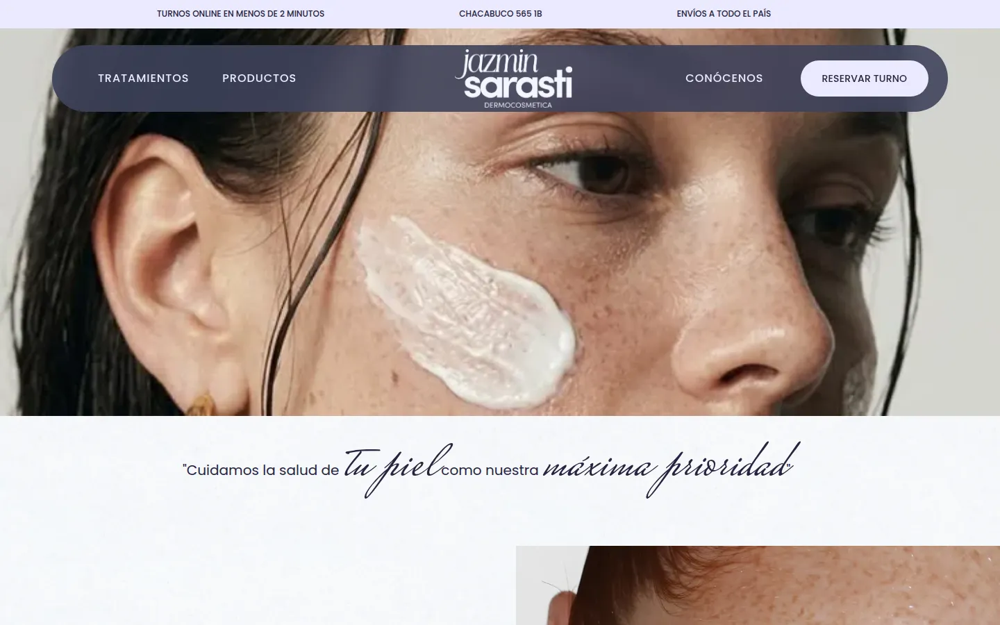
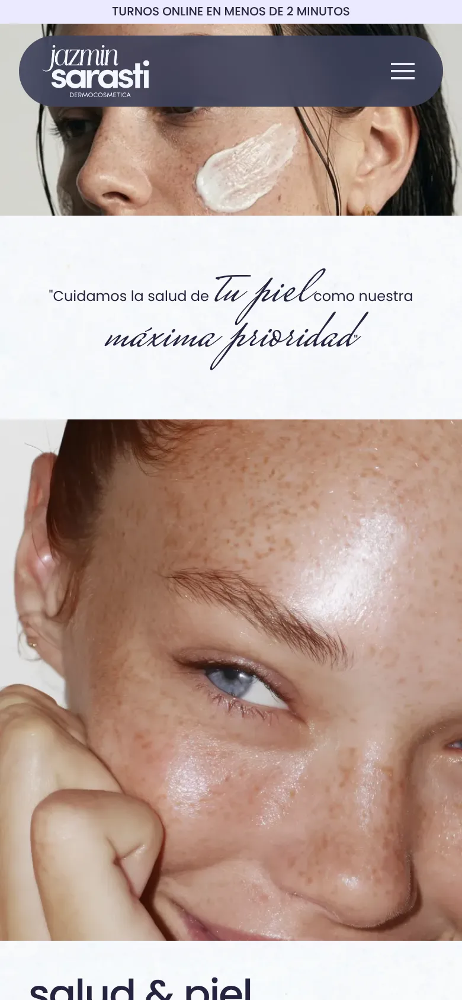
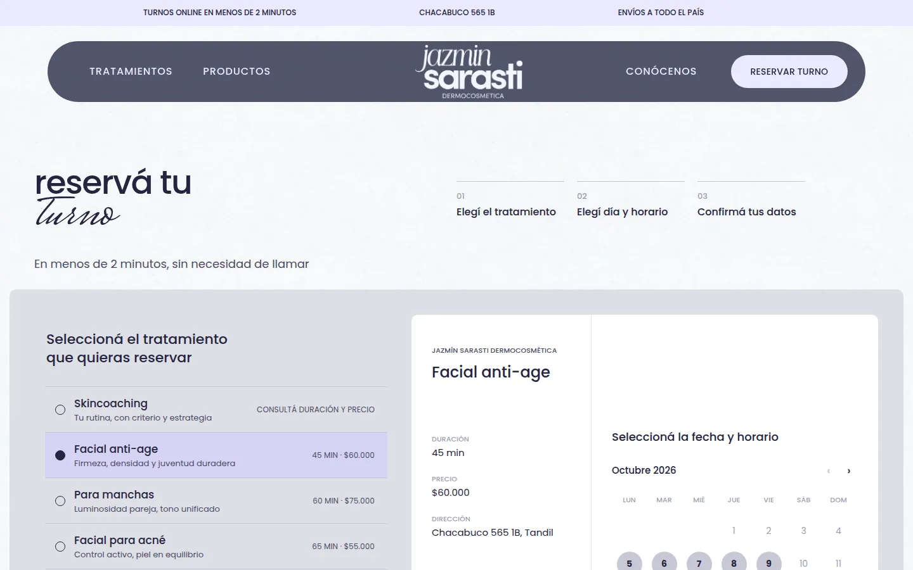
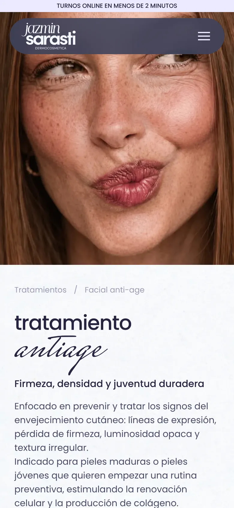
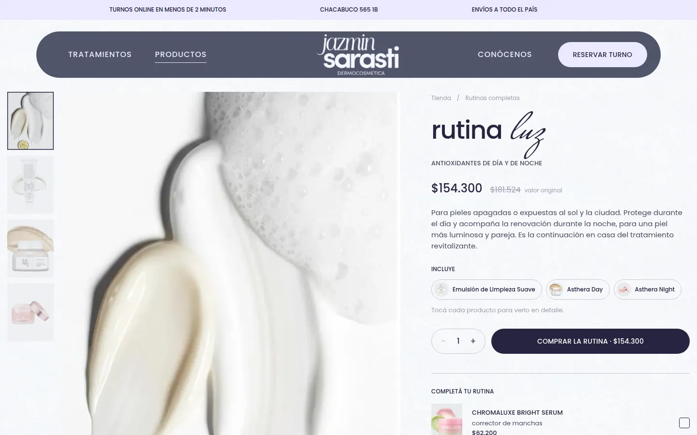
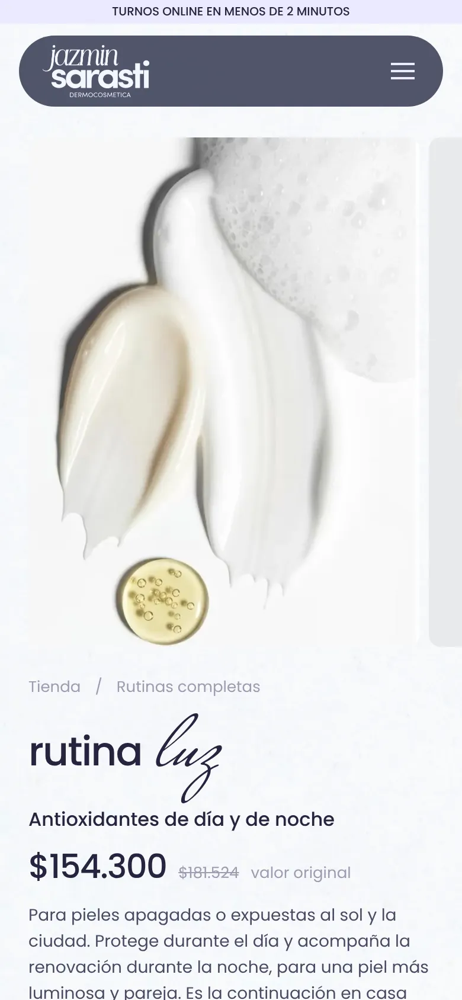

# Jazmín Sarasti Dermocosmética

Sitio web para un consultorio de dermocosmética en Tandil. Presenta los tratamientos, permite reservar un turno y armar un pedido de productos para retirar en el consultorio.

Es un proyecto de portfolio de **Lucía Romeo Gago**: hice el diseño UX/UI en Figma y el desarrollo frontend en React, a partir de ese diseño.

- Diseño: [Figma](https://www.figma.com/design/jOONiVqNAMVfCLfyk5uzUo/Dermatocosmetica)
- Demo: [web-consultorio-dermatocosmiatra.vercel.app](https://web-consultorio-dermatocosmiatra.vercel.app/)

| Escritorio | Celular |
| --- | --- |
|  |  |
|  |  |
|  |  |

## Del diseño al código

Cada página parte de un frame de Figma de escritorio (1440 px) y otro de celular (390 px). Medí las posiciones de los textos del sitio contra las de Figma. En las ocho páginas principales la diferencia es de pocos píxeles.

- Los colores, los tamaños de texto y los espacios de Figma pasan a variables CSS (`src/styles/tokens.css`).
- Los tamaños se escalan entre celular y escritorio con `clamp()`.
- Cuando el diseño de celular cambia la estructura de una sección y no solo su tamaño, esa sección tiene su propia versión para celular. Por ejemplo, un panel con fotos que se deslizan pasa a ser un carrusel de tarjetas.

## Stack

| | |
| --- | --- |
| Interfaz | React 18 + TypeScript (modo estricto) |
| Build | Vite 5 |
| Rutas | React Router 6 |
| Estilos | CSS con variables, sin librerías de UI |
| Datos | Archivos TypeScript tipados en `src/data` |
| Backend | No tiene: turnos y pedidos se envían por WhatsApp |

## Cómo correrlo

```bash
npm install
npm run dev      # servidor de desarrollo en http://localhost:5173
npm run build    # chequeo de tipos + build de producción en dist/
npm run preview  # sirve la carpeta dist/
```

Las fotos están en `public/img/` y se nombran por su clave (por ejemplo `public/img/458d2dfa0a.webp`). Las exporté del archivo de Figma y las pasé a WebP: bajaron de 32 MB a 4 MB.

## Estructura

```text
src/
├── main.tsx            entrada: router y proveedor del pedido
├── App.tsx             rutas
├── data/               contenido tipado (tratamientos, productos, textos)
├── lib/                lógica sin interfaz: pedido, turnos, validación, WhatsApp
├── components/         piezas reutilizables
├── pages/              una por ruta, cada una con su CSS
└── styles/             tokens.css (variables de Figma) y base.css
```

## Páginas

| Ruta | Qué muestra |
| --- | --- |
| `/` | Inicio |
| `/tratamientos` | Los 10 tratamientos: lista numerada, la foto cambia al elegir uno |
| `/tratamientos/:slug` | Ficha de cada tratamiento, generada desde los datos |
| `/reservas?tratamiento=…` | Reserva de turno: tratamiento, calendario, horario y datos |
| `/tienda?categoria=…` | Productos con filtro por categoría y orden por precio |
| `/tienda/:slug` | Ficha de producto, con galería y productos para completar la rutina |
| `/pedido` | Pedido con datos de contacto y forma de pago |
| `/conocenos` | La profesional, su enfoque y sus valores |

## Decisiones técnicas

- **El contenido está separado de la interfaz.** Los 10 tratamientos salen de un solo archivo de datos y una sola plantilla. Para sumar un tratamiento alcanza con agregar un objeto: aparece en el índice, en la reserva y en el pie.
- **No hay backend.** El turno y el pedido se arman como un mensaje de WhatsApp listo para enviar (`src/lib/whatsapp.ts`). No se guardan datos personales ni se cobra online.
- **El estado del pedido usa `useReducer` + Context** (`src/lib/cart.tsx`). Se guarda en `localStorage` y descarta los productos que ya no están en el catálogo.
- **El filtro y el tratamiento elegido viven en la URL** (`?categoria=`, `?tratamiento=`), así se pueden compartir y sobreviven al botón "atrás".
- **Los horarios se calculan.** Los turnos posibles dependen de la duración del tratamiento y del horario del consultorio (`src/lib/schedule.ts`).
- **Interacciones del diseño hechas con CSS:** fotos que se deslizan detrás de un panel translúcido, textos que entran desde la derecha y óvalos que marcan la opción elegida. Las fotos que entran y salen se manejan con un atributo `data-state` (antes, activa, después).
- **Accesibilidad:** enlace para saltar al contenido, foco visible, botones con `aria-pressed` o roles de pestaña según el caso, textos alternativos y respeto de `prefers-reduced-motion`.
